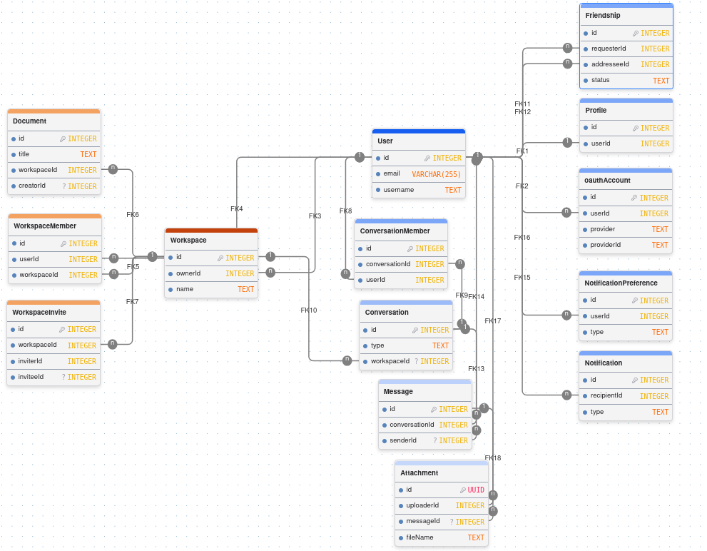

*This project has been created as part of the 42 curriculum by yshi, yanzhao, helin, zhwu, hanwang.*

# ft_transcendence

## Description

ft_transcendence is a full-stack web application designed for real-time communication and collaboration. It allows users to connect with others, manage workspaces, exchange messages and files, and collaborate on documents in a shared environment.

The application combines user authentication, workspace management, real-time communication, and collaborative features in a single platform.

### Features
* Authentication and Security: User registration and login, Google OAuth 2.0, and two-factor authentication.
* User Management: Profiles, avatars, user search, and friendship requests.
* Communication: Direct messages, group conversations, workspace channels, and online presence.
* Workspace Management: Workspaces, member invitations, and role-based permissions.
* Real-Time Notifications: Notifications and configurable notification preferences.
* File Management: File uploads and message attachments.
* Collaborative Documents: Document creation, editing, and real-time collaboration.
* Internationalization: English, French, and Chinese interfaces.


---

# Instructions

## Prerequisites

For the recommended container setup, you need:

* A container engine: Docker Engine or Podman
* A Compose tool: Docker Compose or a compatible alternative, such as podman compose
* GNU Make
* OpenSSL

Note: The exact setup may vary depending on the container engine and Compose implementation. Ensure that the commands and features used by the project are supported by your environment.

Verify the tools for your chosen container setup:

**Option 1: Docker**

```bash
docker --version
docker compose version
make --version
openssl version
```

**Option 2: Podman**

```bash
podman --version
podman compose --version
make --version
openssl version
```

**Note:** Depending on your Podman setup, you may use Docker Compose with Podman's Docker-compatible API instead of `podman compose`. Ensure that your Compose implementation supports the features used by this project.


## Installation

Clone the repository:

```bash
git clone https://github.com/truthciao/42_ft_transcendence.git
cd 42_ft_transcendence
```

## Environment Configuration

Create your local environment configuration from the example provided by the project:

```bash
cp apps/api/.env.example apps/api/.env
```

Configure the required variables in apps/api/.env before starting the application. Replace the placeholder values with your own credentials and settings, including Google OAuth credentials, database passwords, and the JWT secret.

For details, see the
[Environment Configuration Guide](docs/environment-configuration.md).

The .env file and generated secret files are local configuration files and must not be committed to version control.

Once the configuration is complete, start the application:

```bash
make start
```

The Makefile automatically generates the required Docker Compose secret files before starting the services.


## HTTPS

HTTPS is used to reproduce a production-like secure connection and to support browser features that require a secure context.

For more detailed development commands and troubleshooting information, see:

[DEVELOPMENT.md](docs/DEVELOPMENT.md)

---

# Team Information

## Team

The project was developed collaboratively by a five-person team.

| Member | Role | Main Responsibilities |
|---|---|---|
| **yshi** | Product Owner | Product planning, design system, permissions, real-time features |
| **yanzhao** | Project Manager | Project coordination, task tracking, user management, OAuth 2.0, 2FA |
| **helin** | Tech Lead | Technical architecture, database integration, technical decisions, code review |
| **zhwu** | Developer | Notifications, real-time collaboration, internationalization |
| **hanwang** | Developer | File uploads, file management, application integration |

Responsibilities indicate primary ownership; development, integration, testing, and review were collaborative efforts.


---
## Project Management

The team uses **GitHub Issues** for task tracking, **Notion** for project planning and knowledge sharing, and **Discord** for daily communication.

- **Task Tracking & Planning:** Notion Kanban boards track tasks through to-do, in-progress, and completed states. Notion is also used to plan task assignments and distribute responsibilities across the team.
- **Documentation:** Notion centralizes meeting notes, database schema documentation, backend API conventions, architecture diagrams, and user journey flows.
- **Development Workflow:** Development follows a feature-based Git workflow with dedicated branches, Pull Requests, and code reviews before merging into the main branch. Weekly meetings help review progress, identify blockers, and coordinate upcoming work.
- **GitHub–Discord Integration:** A Discord bot sends automatic notifications when Pull Requests are opened or changes are merged on GitHub, keeping the team informed of code review and integration activity.

---
## Technical Stack

### Stack Overview

| Layer | Technologies | Purpose |
|---|---|---|
| **Frontend** | React, TypeScript, Vite, React Router | User interface, routing, and build tooling |
| **Frontend Data & UI** | TanStack Query, Tailwind CSS, shadcn/ui, Base UI, Sonner | Server-state management, styling, reusable components, and notifications |
| **Internationalization** | i18next, react-i18next | Multilingual user interface |
| **Backend** | NestJS, TypeScript | Modular backend and REST API |
| **Validation** | Zod, nestjs-zod | Runtime validation and NestJS DTO integration |
| **Database** | PostgreSQL, Prisma | Relational data storage, type-safe database access, and migrations |
| **Authentication** | JWT, Google OAuth 2.0, TOTP-based 2FA | Authentication and account security |
| **Real-Time Communication** | Socket.IO | Real-time messaging, presence, and collaborative events |
| **Infrastructure** | Docker, Docker Compose, Nginx | Containerization, service orchestration, reverse proxy, and HTTPS |
| **Version Control** | Git, GitHub | Source control, issue tracking, and code review |

### Why These Technologies?

- **React and TypeScript:** React provides reusable UI components to facilitate and standardize the development process. When it comes to TypeScript, the frontend and backend (NestJS) can share data types, allowing errors to be detected immediately at compile-time. 
  
- **NestJS:** NestJS helps us organize our backend business logic in a structured manner by breaking code into dedicated modules, such as auth, chat, and files. It strictly separates controllers from services, ensuring that each file is in charge of a specific responsibility within the backend.

- **PostgreSQL and Prisma:** Our real-time workspace includes friend networks, multiple chat rooms, workspace permission management, and complex interactions among several entities. To maintain data consistency and relational integrity, we chose PostgreSQL as our relational database. We adopted Prisma as our ORM to manage database migrations, which automatically establishes our database schema without having to write SQL manually. On the other hand, it generates TypeScript code so the backend can directly use type-safe methods to manipulate the database efficiently.

- **Socket.IO:** Socket.io enables two-way communication over WebSockets between the frontend and backend. It allows users to receive live updates on the page instantly without refreshing, greatly improving the user experience.

- **Docker Compose and Nginx:** Docker Compose solves the "it works on my machine" problem by packaging services into consistent, reproducible containers. Meanwhile, Nginx serves as the single reverse proxy and HTTPS entry point, ensuring internal services are never directly exposed to the public network, thereby minimizing the attack surface.

The application also uses Docker Compose secrets to provide sensitive configuration to services without hardcoding credentials in the Compose configuration.


---
# Database Design

The application uses **PostgreSQL** and **Prisma ORM** to manage relational data across four main modules:

- **User & Identity** — user profiles, OAuth accounts, and friendships.
- **Workspace & Documents** — workspaces, memberships, invitations, and documents.
- **Messaging** — conversations, members, messages, and attachments.
- **Notifications** — user notifications and notification preferences.

The schema uses foreign keys, unique constraints, and indexes to maintain data integrity and support efficient queries.

<p align="center">
  
</p>

For detailed entity relationships, foreign key constraints, and indexes, see the [Database Documentation](./docs/DATABASE.md).

---

# Features List

The following table summarizes the main implemented features and their primary contributors.

| Feature                    | Primary Contributor(s) | Description                                        |
| -------------------------- | ---------------------- | -------------------------------------------------- |
| User Registration          | yanzhao                | Standard account creation                          |
| User Authentication        | yanzhao                | Login, logout, and authenticated sessions          |
| Google OAuth 2.0           | yanzhao                | Remote authentication through Google               |
| Two-Factor Authentication  | yanzhao                | Additional authentication security                 |
| User Profiles              | zhwu                   | Profile information and account-related UI         |
| Avatar Upload              | zhwu                   | Upload and serve user avatars                      |
| User Search                | yanzhao / team         | Search for other users                             |
| Friendship System          | yanzhao                | Send, accept, reject, and remove friendships       |
| Online Presence            | yshi                   | Real-time online user presence                     |
| Direct Communication       | yanzhao / yshi         | User-to-user communication                         |
| Group Communication        | yanzhao / team         | Group conversations                                |
| Workspace Management       | All                    | Create and manage organizations/workspaces         |
| Workspace Invitations      | All                    | Invite users and manage invitation status          |
| Workspace Roles            | yshi                   | OWNER, ADMIN, and MEMBER permissions               |
| Advanced Permissions       | yshi                   | Role-based workspace access control                |
| Workspace Channels         | All                    | Create and manage workspace communication channels |
| Notifications              | zhwu                   | Notification creation, retrieval, and lifecycle    |
| Notification Preferences   | zhwu                   | Configure notification delivery preferences        |
| Real-Time Notifications    | zhwu / yshi            | Deliver relevant events without page refresh       |
| Collaborative Documents    | zhwu                   | Workspace document creation and management         |
| Real-Time Collaboration    | zhwu                   | Real-time collaborative document functionality     |
| File Upload and Management | hanwang                | Upload and manage application files                |
| Message Attachments        | hanwang                | Attach files to messages                           |
| Internationalization       | zhwu                   | English, French, and Chinese interfaces            |
| Browser Compatibility      | All                    | Support for additional browsers                    |
| Custom Design System       | yshi                   | Reusable components and consistent visual language |
| HTTPS                      | helin                  | Secure development environment using Nginx/TLS     |

---

# Modules

The project includes the following modules selected from the 42 ft_transcendence subject.

Points are calculated according to the subject:

* **Major module = 2 points**
* **Minor module = 1 point**

## Web

| Module                                                                        | Type  | Points | Contributor(s) | Implementation                                                                  |
| ----------------------------------------------------------------------------- | ----- | -----: | -------------- | ------------------------------------------------------------------------------- |
| Use a framework for both the frontend and backend                             | Major |      2 | helin          | React is used for the frontend and NestJS for the backend                       |
| Implement real-time features using WebSockets or similar technology           | Major |      2 | yshi           | Socket.IO is used for real-time events and presence                             |
| Allow users to interact with other users                                      | Major |      2 | yanzhao        | User search, friendships, communication, and interaction features               |
| Use an ORM for the database                                                   | Minor |      1 | helin          | Prisma is used for PostgreSQL database access                                   |
| A complete notification system for all creation, update, and deletion actions | Minor |      1 | zhwu           | Notification models, services, preferences, and real-time notification delivery |
| Real-time collaborative features                                              | Minor |      1 | zhwu           | Collaborative workspace document functionality                                  |
| Custom-made design system with reusable components                            | Minor |      1 | yshi           | Custom reusable UI components and consistent design tokens                      |
| File upload and management system                                             | Minor |      1 | hanwang        | File upload, metadata management, and message attachments                       |

**Web subtotal: 11 points**

## Accessibility and Internationalization

| Module                          | Type  | Points | Contributor(s) | Implementation                                                                                                              |
| ------------------------------- | ----- | -----: | -------------- | --------------------------------------------------------------------------------------------------------------------------- |
| Support for multiple languages  | Minor |      1 | zhwu           | The application supports English, French, and Chinese using i18next/react-i18next.                                          |
| Support for additional browsers | Minor |      1 | All            | The application is developed and tested with multiple modern browsers to ensure consistent functionality and compatibility. |

**Accessibility & Internationalization subtotal: 2 points**

## User Management

| Module                                                                    | Type  | Points | Contributor(s) | Implementation                                                   |
| ------------------------------------------------------------------------- | ----- | -----: | -------------- | ---------------------------------------------------------------- |
| Standard user management and authentication                               | Major |      2 | yanzhao        | Registration, login, logout, sessions, and account management    |
| Advanced permissions system                                               | Major |      2 | yshi           | Workspace roles and role-based access control                    |
| An organization system                                                    | Major |      2 | All            | Workspaces, members, invitations, roles, channels, and documents |
| Implement remote authentication with OAuth 2.0                            | Minor |      1 | yanzhao        | Google OAuth 2.0 integration                                     |
| Implement a complete 2FA (Two-Factor Authentication) system for the users | Minor |      1 | yanzhao        | Two-factor authentication workflow and account security          |

**User Management subtotal: 8 points**

## Total

| Category                             | Points |
| ------------------------------------ | -----: |
| Web                                  |     11 |
| Accessibility & Internationalization |      2 |
| User Management                      |      8 |
| **Total**                            | **21** |

The module implementations were developed as part of the overall application and integrated across frontend, backend, database, and real-time services where required.

---

# Individual Contributions

## yshi — Product Owner

### Responsibilities

* Product planning and feature priorities
* Custom-made design system
* Advanced permissions system
* Real-time functionality
* Product-level technical and UX decisions

### Main Contributions

* Custom reusable UI components and design system
* Workspace permission and role-based access control
* Real-time presence and related real-time functionality
* Product coordination and feature prioritization

### Challenges

One of the main challenges was maintaining consistent permissions across workspace-related features while keeping the application easy to use.

The solution was to establish a common workspace role system based on:

```text
OWNER
ADMIN
MEMBER
```

and reuse the same permission mechanism across workspace operations.

---

## yanzhao — Project Manager

### Responsibilities

* Project coordination
* Task distribution
* Progress tracking
* User management and authentication
* User interaction
* OAuth 2.0
* Two-factor authentication

### Main Contributions

* Standard user authentication
* User interaction features
* Friendship functionality
* Google OAuth 2.0
* Two-factor authentication
* Project coordination and task organization

### Challenges

Authentication required coordination between frontend and backend, including authenticated sessions and protected API access.

The implementation separates authentication responsibilities between the frontend authentication state and backend authentication/authorization mechanisms.

---

## helin — Tech Lead

### Responsibilities

* Technical architecture
* Frontend/backend framework integration
* ORM and database architecture
* Technical decisions
* Code review and technical coordination
* HTTPS infrastructure

### Main Contributions

* React and NestJS application architecture
* Prisma ORM integration
* PostgreSQL database integration
* Shared frontend/backend development structure
* HTTPS configuration using Nginx and TLS
* Technical decisions and code review

---

## zhwu — Developer

### Responsibilities

* User profiles
* Notification system
* Real-time collaborative features
* Internationalization

### Main Contributions

* User profile functionality
* Profile information management
* Notification system
* Notification preferences
* Real-time notification-related functionality
* Collaborative document functionality
* Multilingual support
* English, French, and Chinese localization

### Challenges

Real-time collaboration requires changes made by one user to be propagated to other connected users without requiring a page refresh.

The project uses Socket.IO-based real-time communication together with document state management to synchronize collaborative activity.

Internationalization also requires keeping translated resources consistent across supported languages. Translation keys are maintained separately for English, French, and Chinese.

---

## hanwang — Developer

### Responsibilities

* File upload and management system
* File-related application integration
* General development and feature integration

### Main Contributions

* File upload functionality
* Attachment management
* Message attachments
* Integration of uploaded files into application features

### Challenges

Uploaded files require both file-system handling and database metadata.

The implementation separates the stored file from its database metadata, allowing the application to track information such as:

```text
fileName
fileUrl
fileType
fileSize
uploaderId
messageId
```

---

# Project Structure

The repository is organized as a pnpm monorepo:

```text
42_ft_transcendence/
├── apps/
│   ├── web/                 # React frontend
│   └── api/                 # NestJS backend
│
├── packages/
│   └── shared-types/        # Shared TypeScript/Zod types and schemas
│
├── docs/                    # Project and development documentation
├── infra/                   # Infrastructure configuration
├── scripts/                 # Development and validation scripts
│
├── compose.yaml             # Docker Compose configuration
├── Makefile                 # Common project commands
├── package.json             # Root workspace configuration
├── pnpm-workspace.yaml      # pnpm workspace definition
└── README.md
```

---
## Architecture
The application follows a containerized full-stack architecture managed by Docker Compose. Nginx serves as the reverse proxy, connecting the React frontend and NestJS API to PostgreSQL and persistent file storage.
For a detailed overview of the system architecture, service responsibilities, and networking, see the [Architecture Documentation](/docs/ARCHITECTURE.md).


# Resources

## Documentation and References

The project was developed using official documentation and technical references, including:

* React documentation
* TypeScript documentation
* Vite documentation
* React Router documentation
* TanStack Query documentation
* NestJS documentation
* Prisma documentation
* PostgreSQL documentation
* Socket.IO documentation
* Zod documentation
* i18next documentation
* Docker documentation
* Docker Compose documentation
* Nginx documentation
* OAuth 2.0 / Google OAuth documentation

These resources were used to understand APIs, frameworks, configuration, database operations, authentication, real-time communication, and development best practices.

## AI Usage

AI tools were used as development assistants during the project.

AI assistance was mainly used for:

* Understanding unfamiliar technical concepts and APIs.
* Explaining React, TypeScript, NestJS, Prisma, WebSocket, and authentication concepts.
* Investigating and debugging frontend/backend integration issues.
* Reviewing database schemas and Prisma relationships.
* Helping diagnose TypeScript and dependency errors.
* Reviewing internationalization coverage and translation-key usage.
* Assisting with test design and debugging.
* Reviewing security-related implementation details.
* Improving technical documentation and README organization.
* Discussing implementation approaches before writing or modifying code.

AI was used as an assistant for research, explanation, debugging, and review. The team remained responsible for the final implementation, integration, testing, and code decisions.

---

# Development Documentation

Additional technical information, including detailed development commands, Prisma workflows, database operations, Docker usage, HTTPS configuration, and troubleshooting, is available in:

`docs/DEVELOPMENT.md`

---

# License

This project was created as part of the **42 curriculum**.

Unless otherwise specified by the project repository, the source code is intended for educational purposes within the context of the 42 curriculum.
