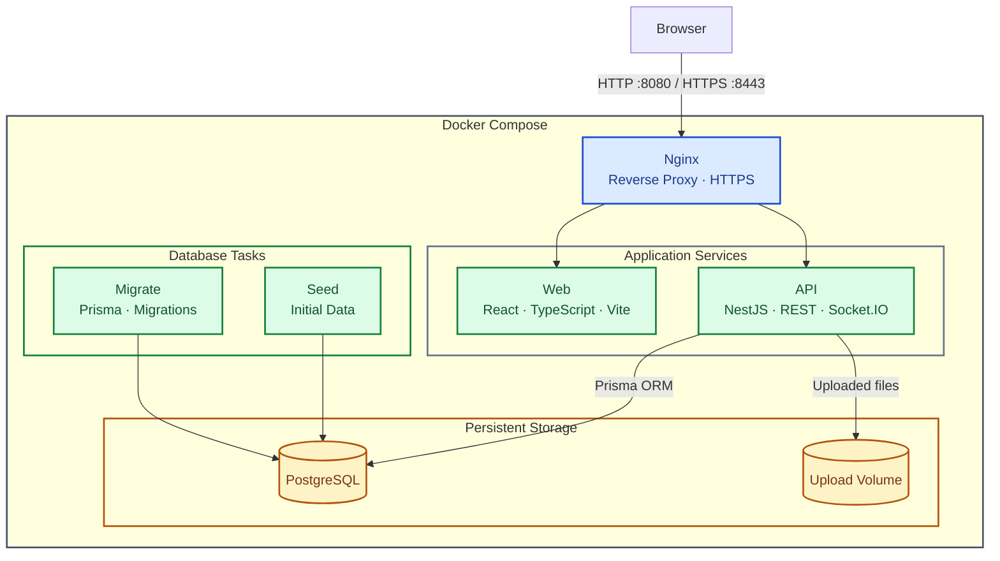

# Architecture Overview

The application follows a containerized full-stack architecture managed by Docker Compose.

Nginx acts as the reverse proxy and HTTPS entry point, routing requests to the React frontend and NestJS API. The API uses Prisma ORM to interact with PostgreSQL and stores uploaded files in persistent storage.

Real-time communication is handled by Socket.IO within the NestJS API. Database migrations and initial data seeding are handled by separate database tasks.

## System Architecture

## Main Components

- **Nginx** — Entry point for HTTP and HTTPS traffic; routes requests to the frontend and API.
- **Web** — React frontend built with TypeScript and Vite.
- **API** — NestJS backend providing REST endpoints and real-time communication through Socket.IO.
- **PostgreSQL** — Persistent relational database.
- **Prisma** — ORM used by the API and migration workflow.
- **Upload Volume** — Persistent storage for uploaded files.
- **Migrate** — Applies database schema migrations.
- **Seed** — Initializes the database with initial data when required.

## Networking

The application exposes HTTP on port `8080` and HTTPS on port `8443` through Nginx. Services communicate over the Docker Compose network.

Database access should remain internal to the Compose network unless external access is explicitly required.