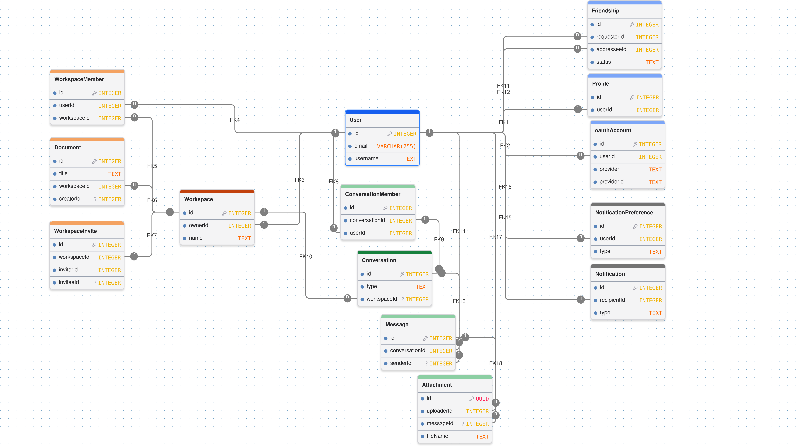

# Database Schema

## Database Overview

The database schema is organized around four main functional areas: **User & Identity**, **Workspace & Documents**, **Messaging**, and **Notifications**.

The database panorama below illustrates the relationships between the entities, their foreign keys, and the main structural constraints.

  

### Diagram Legend

- **Blue:** User and identity-related entities.
- **Orange:** Workspace and document-related entities.
- **Green:** Messaging-related entities.
- **Grey:** Notification-related entities.
- **FK1–FK18:** Reference identifiers used to describe the relationships between tables in the diagram.

### Key Reference

The table below documents the key relationships shown in the database diagram, including their corresponding fields, cardinality, and relevant constraints. The Prisma schema defines the complete set of database relationships and constraints.

| FK | Referenced Field | Foreign Key Field | Cardinality | Notes |
|---|---|---|---|---|
| FK1 | `User.id` | `Profile.userId` | 1:1 | `userId` is unique; a profile is optional for a user. |
| FK2 | `User.id` | `OAuthAccount.userId` | 1:N | A user can link multiple OAuth accounts. |
| FK3 | `User.id` | `Workspace.ownerId` | 1:N | References the workspace owner. |
| FK4 | `User.id` | `WorkspaceMember.userId` | 1:N | Links a user to workspace memberships. |
| FK5 | `Workspace.id` | `WorkspaceMember.workspaceId` | 1:N | Links a workspace to its members. |
| FK6 | `Workspace.id` | `Document.workspaceId` | 1:N | Links a document to its workspace. |
| FK7 | `Workspace.id` | `WorkspaceInvite.workspaceId` | 1:N | Links an invitation to its workspace. |
| FK8 | `User.id` | `ConversationMember.userId` | 1:N | Links a user to conversation memberships. |
| FK9 | `Conversation.id` | `ConversationMember.conversationId` | 1:N | Links a conversation to its members. |
| FK10 | `Workspace.id` | `Conversation.workspaceId` | 1:N | Optional relationship; a conversation may have no workspace. |
| FK11 | `User.id` | `Friendship.requesterId` | 1:N | Identifies the user initiating a friendship request. |
| FK12 | `User.id` | `Friendship.addresseeId` | 1:N | Identifies the user receiving a friendship request. |
| FK13 | `Conversation.id` | `Message.conversationId` | 1:N | Links a message to its conversation. |
| FK14 | `User.id` | `Message.senderId` | 1:N | Optional relationship; deletion sets `senderId` to `NULL`. |
| FK15 | `User.id` | `Notification.recipientId` | 1:N | Identifies the notification recipient. |
| FK16 | `User.id` | `NotificationPreference.userId` | 1:N | Preferences can be stored by notification type. |
| FK17 | `User.id` | `Attachment.uploaderId` | 1:N | Identifies the attachment uploader. |
| FK18 | `Message.id` | `Attachment.messageId` | 1:N | Optional relationship; an attachment may have no associated message. |

**Note:** Cardinality is expressed from the referenced entity to the referencing entity. Optional relationships allow NULL foreign-key values. 

## Main Entities

| Entity                   | Purpose                               | Key Fields                                                                                |
| ------------------------ | ------------------------------------- | ----------------------------------------------------------------------------------------- |
| `User`                   | User account and authentication data  | `id`, `email`, `username`, `passwordHash`, `isTwoFactorEnabled`, `createdAt`, `updatedAt` |
| `Profile`                | User profile information              | `id`, `userId`, `displayName`, `bio`, `avatarUrl`, `preferredLanguage`                    |
| `OAuthAccount`           | External OAuth account associations   | `id`, `userId`, `provider`, `providerId`                                                  |
| `Friendship`             | Friendship requests and relationships | `id`, `requesterId`, `addresseeId`, `status`, `createdAt`, `updatedAt`                    |
| `Notification` | User, friendship, workspace, and messaging notifications | `id`, `recipientId`, `actorId`, `type`, `friendshipId`, `workspaceId`, `conversationId`, `read`, `createdAt` |
| `NotificationPreference` | Per-user notification preferences     | `id`, `userId`, `type`, `viaInApp`, `viaEmail`                                            |
| `Workspace`              | Organization/workspace                | `id`, `name`, `slug`, `description`, `icon`, `ownerId`                                    |
| `WorkspaceMember`        | Workspace membership and role         | `id`, `workspaceId`, `userId`, `role`, `joinedAt`                                         |
| `WorkspaceInvite`        | Workspace invitation management       | `id`, `workspaceId`, `inviterId`, `inviteeId`, `role`, `status`, `token`, `expiresAt`     | 
| `Document`               | Collaborative workspace documents     | `id`, `title`, `content`, `yjsState`, `workspaceId`, `creatorId`                          |
| `Conversation` | Direct, group, or workspace channel | `id`, `type`, `name`, `workspaceId`, `isDefault`, `createdById` |
| `ConversationMember`     | User membership in conversations      | `id`, `conversationId`, `userId`, `joinedAt`, `lastReadMessageId`                         |
| `Message`                | Messages sent in conversations        | `id`, `conversationId`, `senderId`, `content`, `createdAt`                                |
| `Attachment`             | Uploaded file metadata                | `id`, `uploaderId`, `messageId`, `fileName`, `fileUrl`, `fileType`, `fileSize`            |

## Enums

The schema defines the following enums:

- `UserRole`: `USER`, `ADMIN`
- `PreferredLanguage`: `en`, `fr`, `zh`
- `WorkspaceRole`: `OWNER`, `ADMIN`, `MEMBER`
- `WorkspaceInviteStatus`: `PENDING`, `ACCEPTED`, `REJECTED`, `REVOKED`
- `ConversationType`: `DIRECT`, `GROUP`, `CHANNEL`
- `FriendshipStatus`: `PENDING`, `ACCEPTED`, `BLOCKED`
- `NotificationType`: `FRIEND_REQUEST_RECEIVED`, `FRIEND_REQUEST_ACCEPTED`, `FRIEND_REQUEST_REJECTED`, `FRIEND_REMOVED`, `WORKSPACE_INVITE_RECEIVED`, `WORKSPACE_INVITE_ACCEPTED`, `WORKSPACE_MEMBER_REMOVED`, `WORKSPACE_ROLE_CHANGED`, `MESSAGE_RECEIVED`

## Database Constraints and Indexes

The schema defines primary keys, foreign keys, unique constraints, indexes, and referential actions to maintain data integrity and support common queries.

Examples include:

- `User.email` and `User.username` are unique.
- `Profile.userId` is unique, enforcing a one-to-one relationship between `User` and `Profile`.
- `OAuthAccount` has a unique constraint on `(provider, providerId)`.
- `Workspace.slug` and `WorkspaceInvite.token` are unique.
- `WorkspaceMember` has a unique constraint on `(workspaceId, userId)`.
- `ConversationMember` has a unique constraint on `(conversationId, userId)`.
- `Friendship` has a unique constraint on `(requesterId, addresseeId)`.
- `NotificationPreference` has a unique constraint on `(userId, type)`.
- Indexes support queries involving workspace membership, workspace invitations, conversations, friendships, notifications, and documents.
- Referential actions such as `Cascade` and `SetNull` define how related records are handled when referenced records are deleted.